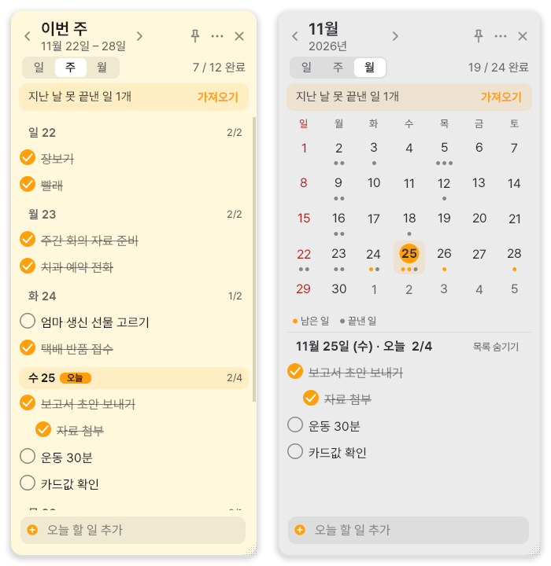
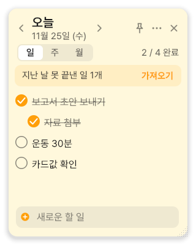
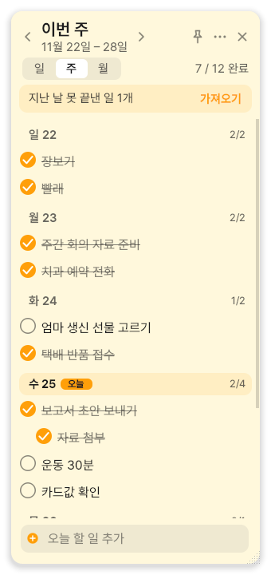
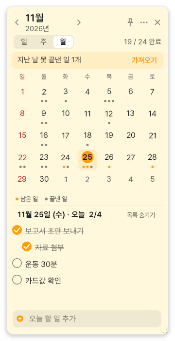
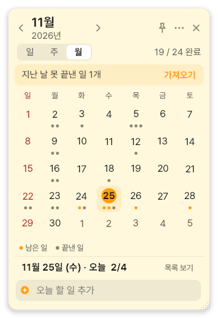
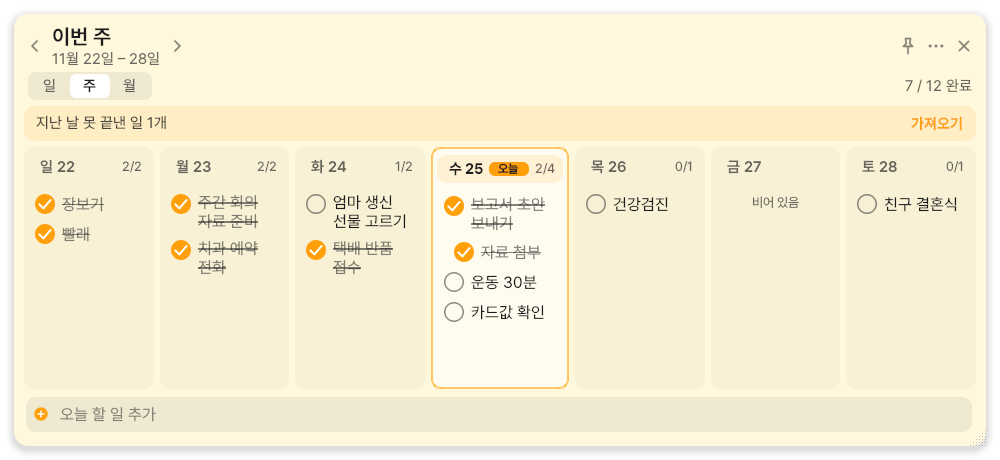
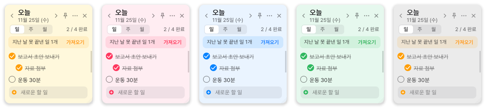
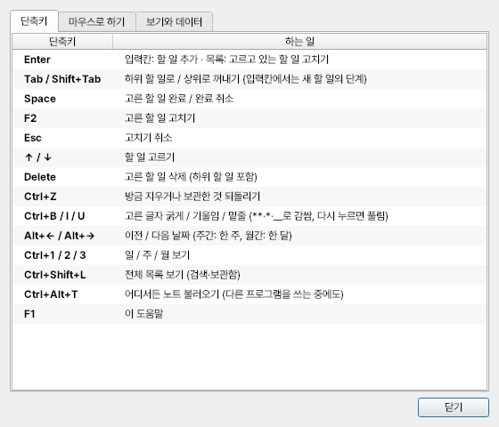

<p align="center">
  
</p>

<h1 align="center">Sticky Todo</h1>

<p align="center">
  바탕화면 한쪽에 포스트잇처럼 붙여 두는 할 일 목록이에요.<br>
  오늘 할 일부터 이번 주, 이번 달까지 한눈에 보고, 못 끝낸 일은 쓱 끌어서 다른 날로 넘기면 돼요.
</p>

<p align="center">
  <a href="https://github.com/jxxngxn00/sticky-todo/releases/latest"></a>
  <a href="https://github.com/jxxngxn00/sticky-todo/actions/workflows/build.yml"></a>
  <a href="LICENSE"></a>
  
</p>

<p align="center">
  <a href="https://github.com/jxxngxn00/sticky-todo/releases/latest/download/StickyTodo-Setup.exe"><b>설치 프로그램 받기 (StickyTodo-Setup.exe)</b></a>
</p>

<p align="center">
  
</p>

<p align="center">
  적은 내용은 모두 내 PC에만 저장돼요. 인터넷은 새 버전이 나왔는지 확인할 때만 써요.
</p>

## 이렇게 써요

|  |  |
|---|---|
|  | **오늘 할 일**<br>아래 칸에 적고 Enter만 누르면 끝이에요.<br>Tab을 누르면 하위 할 일이 되고, 고치고 싶을 땐 더블클릭하면 돼요.<br>어제 못 끝낸 일이 있으면 위에 알려줘요. **가져오기**를 누르면 오늘로 한 번에 옮겨와요. |
|  | **이번 주** (Ctrl+2)<br>일요일부터 토요일까지 날짜별로 이어서 보여줘요.<br>날짜를 누르면 그 날에 바로 적을 수 있고,<br>할 일을 **다른 날로 끌어다 놓으면** 그 날로 옮겨져요. |
|  | **이번 달** (Ctrl+3)<br>주황 점은 아직 남은 일, 회색 점은 끝낸 일이에요.<br>날짜를 누르면 아래에 그 날 할 일이 나오고,<br>할 일을 달력 날짜 위로 끌어다 놓으면 그 날로 옮겨져요. |
|  | **달력만 보고 싶을 때**<br>[목록 숨기기]를 누르거나 노트를 낮게 줄이면 달력만 남아요.<br>바탕화면 구석에 작은 달력처럼 두기 좋아요. |

**넓은 화면에서는 주간 보드로** · 주간 보기에서 노트를 가로로 넉넉하게(960px 이상) 늘리면
일주일이 7칸 보드로 펼쳐져요. 칸을 누르면 그 날이 골라지고, 칸 사이로 끌어서 날짜를 옮길 수 있어요.

<p align="center"></p>

**좋아하는 색으로** · 노랑, 분홍, 하늘, 민트, iOS 중에 골라 보세요 (☰ → 색상).
설정에서 색을 직접 골라도 날짜나 안내 글자가 흐려져서 안 보이는 일이 없도록, 배경에 맞춰 글자 진하기를 알아서 맞춰줘요.

<p align="center"></p>

## 설치하기

1. 위의 **[설치 프로그램 받기](https://github.com/jxxngxn00/sticky-todo/releases/latest/download/StickyTodo-Setup.exe)** 를 눌러서 받은 파일을 실행해 주세요.
   - 브라우저가 "일반적으로 다운로드되지 않는 파일"이라고 하면 **⋯ → 유지**를 눌러 주세요.
   - 파란 **"Windows의 PC 보호"** 창이 뜨면 **추가 정보 → 실행**을 누르면 돼요.
     개인이 만든 프로그램이라 코드 서명이 없어서 뜨는 안내예요.
2. **다음 → 설치**를 누르면 끝이에요. 관리자 권한은 필요 없어요.
   - 내 계정 폴더(`%LOCALAPPDATA%\Programs\StickyTodo`)에 설치되고 시작 메뉴에도 생겨요.
   - 바탕화면 바로가기와 윈도우 켤 때 자동 실행은 설치 화면에서 고를 수 있어요.
3. **업데이트**할 때는 새 설치 파일을 받아서 다시 실행하면 돼요. 적어 둔 할 일은 그대로 남아요.
4. **지우고 싶을 때**는 설정 → 앱 → Sticky Todo → 제거. 할 일 데이터까지 지울지 한 번 더 물어봐요.

<details>
<summary>설치 없이 쓰고 싶어요 · 받은 파일이 진짜인지 확인하고 싶어요</summary>

- 릴리즈의 `StickyTodo.exe`(실행 파일 하나짜리)를 받아서 원하는 폴더에 두고 실행해도 돼요.
- 받은 파일이 원본 그대로인지는 같이 올라간 `.sha256` 값과 비교해 보면 알 수 있어요.

```powershell
Get-FileHash .\StickyTodo-Setup.exe -Algorithm SHA256
```
</details>

## 사용법

헷갈릴 땐 노트에서 **F1**을 눌러 보세요. 단축키와 마우스로 할 수 있는 것들을 모아 뒀어요.

<p align="center"></p>

| 이럴 땐 | 이렇게 |
|---|---|
| 할 일 적기 | 아래 칸에 쓰고 Enter (Tab을 누르면 하위 할 일) |
| 고치기 / 하위 할 일로 | 더블클릭 / Tab (다시 꺼낼 땐 Shift+Tab) |
| 내일로 미루기, 다른 날로, 보관, 삭제 | 할 일에서 우클릭 |
| 다른 날로 옮기기 | 주간·보드·달력에서 다른 날로 끌어다 놓기, 또는 우클릭 → **날짜 고르기…** |
| 글자 꾸미기 | `**굵게**` `*기울임*` `~~취소선~~` `__밑줄__`, 또는 글자를 고르고 Ctrl+B / I / U |
| 실수로 지웠어요 | 아래 알림의 **되돌리기**(10초 동안), ☰ → 방금 지운 것 되돌리기, 또는 Ctrl+Z |
| 하루 · 주 · 달 바꿔 보기 | 제목 아래 **일 / 주 / 월**, 또는 Ctrl+1 / 2 / 3 |
| 날짜 넘기기 | 제목 옆 ‹ ›, 또는 Alt+← / Alt+→ (제목을 더블클릭하면 오늘로) |
| 예전 할 일 찾기, 보관함 | ☰ → 전체 목록 보기, 또는 Ctrl+Shift+L |
| 다른 프로그램 쓰다가 바로 열기 | **Ctrl+Alt+T** (설정 → 목록 동작에서 끌 수 있어요) |
| 잠깐 숨기기 / 다시 보기 | ✕를 누르면 작업표시줄 트레이로 숨어요. 트레이 아이콘을 누르면 다시 나와요 |
| 완전히 끄기 | ☰ → 종료, 또는 트레이 아이콘 우클릭 → 종료 |
| 윈도우 켤 때 같이 켜기 | ☰ 또는 트레이 메뉴 → 시작 시 자동 실행 |

<details>
<summary>트레이 아이콘이 안 보여요 · 자동 실행은 어떻게 되나요</summary>

- 윈도우 11은 새 트레이 아이콘을 작업표시줄의 **^(숨겨진 아이콘)** 안에 넣어 둬요.
  항상 보이게 하려면 아이콘을 작업표시줄로 끌어다 놓거나,
  설정 → 개인 설정 → 작업 표시줄 → 기타 시스템 트레이 아이콘에서 Sticky Todo를 켜 주세요.
- 자동 실행은 `HKCU\Software\Microsoft\Windows\CurrentVersion\Run`에 프로그램 위치를 적어 두는 방식이에요
  (관리자 권한 필요 없음). 프로그램을 다른 폴더로 옮겨도 다음에 켤 때 위치를 알아서 고쳐요.
</details>

## 조금 더 자세히

<details>
<summary>하위 할 일</summary>

- 몇 단계든 들여쓸 수 있어요. 위 항목을 옮기거나 지우면 하위 항목도 같이 따라가요.
- 완료 체크는 누른 항목만 바뀌어요. 위 항목을 끝냈다고 하위 항목까지 끝나진 않아요.
- 텍스트 파일(`- [ ] 할 일` 같은 체크리스트 형식)로 저장할 땐 한 단계에 공백 2칸으로 써요.
  불러올 땐 공백 2칸, 4칸, 탭 모두 알아들어요.
</details>

<details>
<summary>날짜별 페이지 · 주간 · 월간</summary>

- 내일이나 다음 주 페이지에 미리 적어 둘 수 있어요. 자정이 지나면 노트가 알아서 새 '오늘'로 넘어가요.
- 못 끝낸 일은 그 날짜에 그대로 남아 있고, 오늘 페이지 위에 **가져오기** 알림이 떠요.
- 날짜를 더블클릭하면 그 날 하루 보기로 바로 가요.
- 노트 크기는 하루·주간·월간마다 따로 기억해요. 주간은 넓게, 하루는 작게 둘 수 있어요.
- 텍스트 파일로 저장하거나 복사하면 지금 보고 있는 범위(하루 / 한 주 / 한 달)가 날짜별로 정리돼서 나가요.
- 대한민국 공휴일(대체공휴일·선거일 포함)은 달력에서 빨간 숫자로, 주간·하루 보기에서는 '추석' 같은 배지로 보여요.
  - 지금은 2026~2028년이 들어 있어요. 우주항공청 월력요항과 한국천문연구원 달력자료를 기준으로 했어요.
  - 2028년은 공식 월력요항이 나오기 전 자료라, 발표되면 맞춰 보고 고칠게요. 임시공휴일도 지정되면 새 버전에 넣어요.
</details>

<details>
<summary>끝낸 일 보관하기</summary>

- ☰ → **완료 항목 보관**을 누르면 끝낸 일이 보관함으로 들어가요.
  날짜가 바뀔 때 어제까지 끝낸 일을 알아서 보관하기도 해요 (설정에서 끌 수 있어요).
- 보관한 일은 지워진 게 아니에요. 전체 목록 창의 **보관됨**에서 찾아보고, 노트로 되돌리거나 완전히 지울 수 있어요.
</details>

<details>
<summary>텍스트 파일 불러오기는 안전한가요</summary>

- `- [ ]`, `- [x]`, `* [ ]`로 시작하는 줄만 할 일로 읽어요. 내용은 글자 그대로만 보여주고, 링크나 그림 같은 건 해석하지 않아요.
- 파일은 1MB까지, 한 번에 200개까지 불러와요. 50개가 넘으면 먼저 물어봐요.
</details>

## 내 그림으로 꾸미기 (테마)

☰ → 설정 → **테마** 탭에서 노트의 아이콘과 배경을 내 그림으로 바꿀 수 있어요. 글꼴과 색은 그대로예요.

| 바꿀 수 있는 곳 | |
|---|---|
| 고정 핀 버튼 | 꺼져 있으면 흐린 회색, 고정하면 또렷하게. '고정됐을 때 그림'을 따로 넣어도 돼요 |
| 할 일 앞 아이콘 · 끝낸 일 아이콘 | 체크 자리 (하위 할 일도 같은 그림). 설정의 체크 모양보다 먼저예요 |
| 추가 버튼 | 입력칸 왼쪽 + 자리 |
| 오늘 표시 | 월간 달력에서 오늘 날짜 뒤. 숫자는 가운데에 두고 그림을 조금씩 옮겨 맞출 수 있어요 |
| 배경 그림 | 목록 뒤에 흐리게. 노트 위에서 끌어서 원하는 자리에 두고 크기·진하기를 정해요 |

- PNG · JPG · WebP를 넣을 수 있어요. 투명 배경 PNG가 가장 예뻐요.
- 아이콘은 투명한 여백을 잘라내고 정사각형 가운데에 맞춰 저장해서, 어떤 그림이든 칸 가운데에 와요.
- 배경이 너무 진해서 글씨가 안 읽히면 그 이상은 진해지지 않아요. 넓은 보드에서는 배경이 보이지 않아요.
- 처음이라면 **예시 테마 (귤 친구)** 를 눌러 보세요. 설정 창에서 **취소**를 누르면 원래대로 돌아가요.
- 다른 사람이 만든 캐릭터 그림은 저작권을 확인하고 써 주세요.

## 내 할 일은 어디에 저장되나요

- `%APPDATA%\StickyTodo\` 폴더에 있어요.
  - `todos.json`은 할 일, `settings.json`은 설정, `backups\`는 최근 백업 5개, `themes\current\`는 테마 그림이에요.
- exe와 같은 폴더에 `portable`이라는 빈 파일을 만들어 두면, 그 폴더 안 `data\`에 저장해요 (USB에 넣고 다닐 때 좋아요).
- `todos.json`이 망가지면 가장 최근의 멀쩡한 백업으로 알아서 되살려요. 망가진 파일은 `todos.json.corrupt-날짜`로 따로 남겨 둬요.
- 할 일은 **암호화하지 않은 글자 그대로** 저장돼요. 비밀번호 같은 민감한 내용은 적지 말아 주세요.

## 새 버전 알림

- 하루 한 번 GitHub에 **최신 버전 번호만** 물어봐요. 할 일이나 설정은 하나도 보내지 않아요.
- 새 버전이 있으면 트레이에 알림이 떠요. 누르면 릴리즈 페이지가 열리고, 받아서 설치하는 건 직접 해요.
- ☰ → **업데이트 확인**으로 언제든 바로 확인할 수 있어요.
- 인터넷 접속이 싫다면 ☰ → 설정 → **새 버전이 나오면 알려주기**를 꺼 주세요.

## 직접 고쳐 보고 싶다면

Python은 [uv](https://docs.astral.sh/uv/)로 관리해요.

```powershell
winget install astral-sh.uv          # 처음 한 번
uv sync                               # Python 3.12와 필요한 패키지 설치
uv run sticky-todo                    # 실행
uv run pytest                         # 테스트
uv run ruff check .                   # 린트
uv run ruff format .                  # 코드 정리
uv run pip-audit                      # 패키지 보안 점검
uv run python tools/build.py          # exe·설치 프로그램 만들기 → dist\ (Inno Setup 6이 있으면 Setup.exe까지)
uv run python tools/screenshots.py    # README 사진 다시 만들기 → docs\images\ (예시 할 일로)
```

`todos.json` 형식은 v3예요 (할 일마다 `day`가 있고, 보관함은 `archive`). 예전 v1·v2 파일은 읽을 때 알아서 바꿔요.

## 라이선스

MIT ([LICENSE](LICENSE))예요. 함께 들어 있는 PySide6(LGPL-3.0), Pretendard(OFL-1.1) 같은 것들은 [THIRD-PARTY-NOTICES.txt](THIRD-PARTY-NOTICES.txt)에 정리해 뒀어요.
